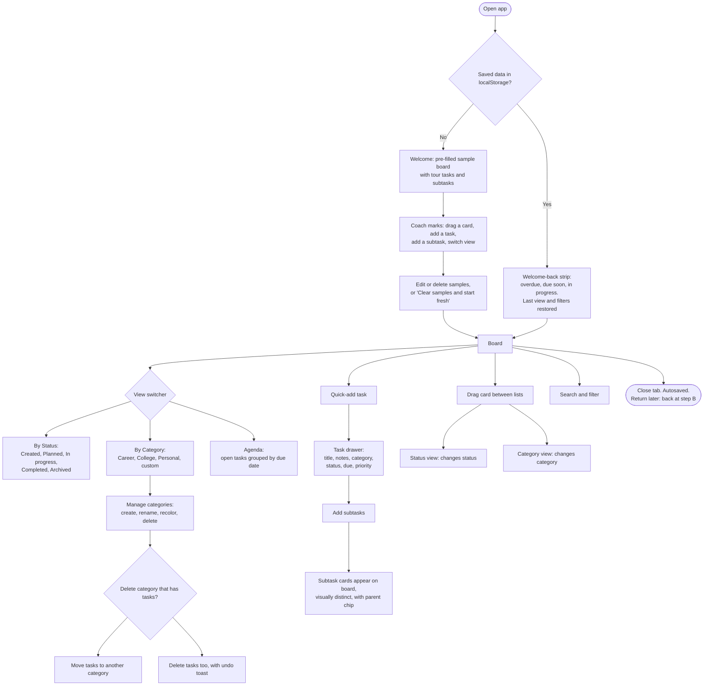
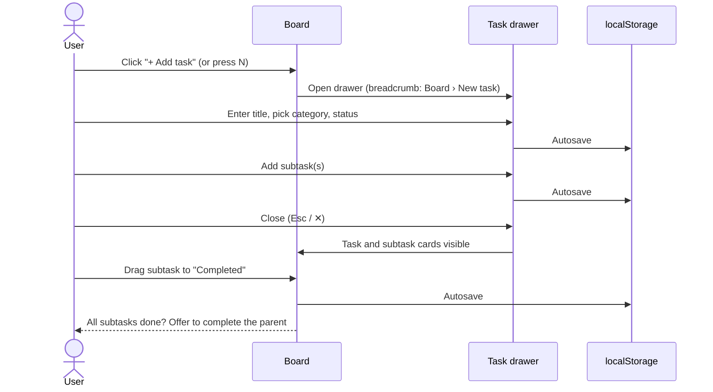
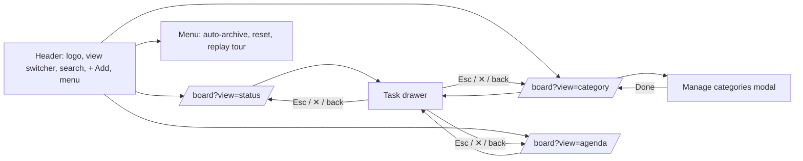

# Kanban To-Do

An interactive kanban to-do board with drag-and-drop cards, two ways of grouping them (by **status** and by **category**) plus a dated **agenda** list, and subtasks that appear as their own (visually distinct) cards. Everything is stored in your browser's `localStorage`. There is no backend, no accounts and no external APIs.

**Stack:** Next.js (App Router) · Tailwind CSS · TypeScript · localStorage

## Design requirements → how we meet them

| Requirement | Approach |
|---|---|
| **Flow** (first visit → core task → return) | See the flow diagrams below. |
| **Onboarding** | A first visit loads a populated sample board plus a short coach tour. There is never an empty screen. One click clears the samples. |
| **Coming back** | Autosave on every change. Last view and search filter are restored. A "Welcome back" strip summarises overdue, due-soon and in-progress work. |
| **Components** | One shared set of primitives (`Button`, `Badge`, `Modal`, `Drawer`, `Toast`, `EmptyState`...) and domain components (`TaskCard`, `Column`, `ViewSwitcher`...). |
| **Navigation** | Persistent header with a view switcher, URL-addressable views, breadcrumb in the task drawer, Esc/back closes overlays. |

## Features

- Drag cards between lists (changes **status** in Status view, **category** in Category view)
- **Status view:** Created → Planned → In progress → Completed → Archived
- **Category view:** Career, College, Personal + create, rename, recolor, delete your own (deleting offers *move tasks* or *delete tasks*, with undo)
- Tasks with notes, due date and priority
- Subtasks with their own independent status. They show as compact, dashed-border cards with a parent chip, and can be dragged like any card
- Search, plus filters (priority, category, due) and per-board sorting (manual, due date, priority)
- Undo toasts, keyboard-accessible drag-and-drop, and long-press drag on touch screens
- Keyboard shortcuts: `N` new task, `/` search, `Cmd/Ctrl+Z` undo, `?` shortcut list
- Relative due dates ("Today", "Tomorrow", "Fri") with a distinct due-today style
- Inline quick-add at the bottom of each column
- Collapsible columns and a WIP limit for "In progress"
- Reorder category columns by dragging their headers (or with the up/down buttons in Manage categories)
- Bulk actions: Shift/Cmd/Ctrl+click to select cards, then move, archive or delete them in one undoable step
- **Agenda view** (`?view=agenda`): a plain list of open tasks grouped Overdue, Today, Tomorrow, This week, Later and No due date, with search and filters applied and a checkbox to finish tasks
- **Recurring tasks:** repeat daily, on weekdays, weekly or monthly (needs a due date). Completing one creates the next occurrence (subtasks copied fresh); undo removes it again
- **Auto-archive:** the header menu can archive completed tasks after 1, 3, 7, 14 or 30 days (checked on load and hourly, with undo)
- **Weekly progress:** a quiet "done this week" count and completion streak above the board
- **Notes in light markdown:** bold, italic, code, links, lists and clickable `- [ ]` checklists; cards show a checklist count
- Filter-aware quick add: a task added into a column but hidden by the current filters tells you and offers to clear them
- **Dark mode:** System / Light / Dark in the header menu. "System" follows your OS live, the choice is remembered, and an inline script applies it before first paint so there is no flash

## User flows

### 1. Overall flow: first visit, core task, returning



### 2. Core task: create a task with subtasks



### 3. Navigation map



## Getting started

```bash
npm install
npm run dev
```

Open <http://localhost:3000>.

## Deploying

The app is fully static/client-side, so it deploys to Vercel with zero configuration.
